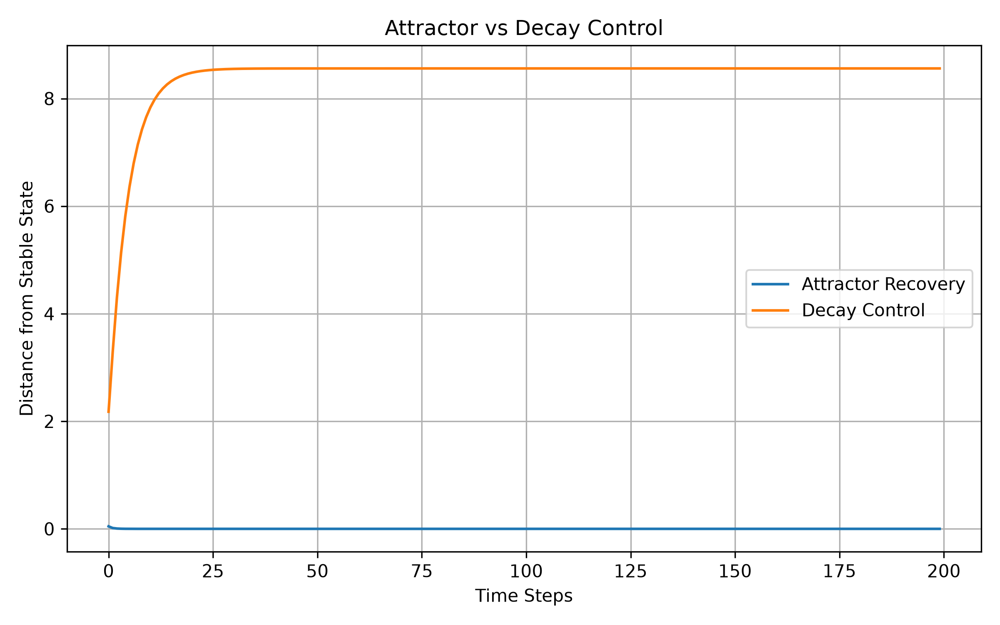

# Attractor Evidence Lab

A small computational neuroscience project exploring attractor dynamics and recovery after perturbation.

## Research Question

Can a recurrent neural network return to its original stable state after a perturbation?

## Experiments

### 1. Attractor Recovery

We perturb the network's stable state with Gaussian noise and measure its distance from the original stable state over time.

### 2. Decay Control

We start a control network from the same perturbed state.

The control network follows a simple decay rule:

state = 0.8 * state

We measure its distance from the original stable state.

## Results

The Attractor model returns close to its original stable state.

The Decay Control model approaches zero activity and moves away from the original stable state.

This comparison suggests that activity decay alone does not explain recovery.

## Visualization

The comparison plot is saved at:

results/control_comparison.png

## Limitations

- This is a simplified computational model.
- The model is not a biologically realistic neural network.
- The results do not prove the existence of attractors in the brain.
- Further experiments and controls are required.

## Technologies

- Python
- NumPy
- Matplotlib